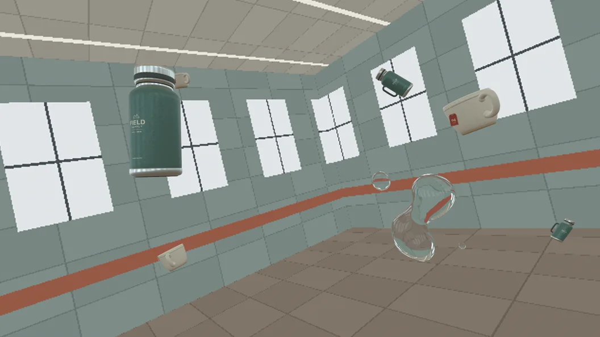

# Three.js · COLMAP Drift

**추가 예제:** [백보드 물 · PnP/OpenGL](examples/backboard_water/README.md) — 원본 촬영 없이 생성되는 데모, 내 영상/모서리 관측 입력, Straight 알파 출력. 최신 물의 실사 룩은 검수 중인 실험 버전입니다. [OBS 종료 시 공간 부족 오경고 수정](docs/obs-stop-profile-race.md)도 함께 정리했습니다.

촬영한 카메라 움직임에 보온병과 찻잔 여섯 개를 띄우고, 무중력 물방울 안으로 배경이 굴절되는 8초 합성을 만드는 예제입니다. 숲길 테스트에서 보정한 192개의 카메라 포즈를 담았습니다. 아래 이미지는 같은 카메라로 공개용 가상 스튜디오를 촬영하고 After Effects에서 합성한 96번 프레임입니다.



## 어떤 도구가 무엇을 만드나

| 단계 | 사용한 도구 | 산출물 |
| --- | --- | --- |
| 촬영 카메라 복원 | COLMAP 희소 복원. 원본 숲길 숏은 OpenCV LK/PnP와 SciPy로 4배 슬로모션 영상에 다시 맞춤 | Three.js에서 읽을 수 있는 프레임별 `matrixWorld`와 카메라 내부 파라미터 |
| 보온병·찻잔 | Three.js 지오메트리, 코드로 그린 텍스처, PBR 재질, GLTFExporter | 텍스처를 내장한 GLB 두 개 |
| 무중력 물방울 | Node.js에서 입자 370개의 압력·응집·점성을 계산. Three.js Marching Cubes로 프레임별 표면 생성 | 입자 캐시와 애니메이션 수면 메시 |
| 물의 최종 픽셀 | Python ModernGL과 네이티브 OpenGL 3.3. 앞·뒷면에서 굴절을 근사하고 프레넬 반사에 HDRI를 사용 | 현재 배경의 굴절이 담긴 ProRes 4444, Straight 알파 |
| 배치와 합성 | Python으로 근·원경 궤적을 만들고 After Effects Advanced 3D에서 여섯 모델을 조명·렌더 | 수정 가능한 AEP, 원본 정렬 알파 컴프, 배경과 CG를 함께 안정화한 시사 컴프 |

## 데모 실행

저장소 루트에서 실행합니다. 확인한 환경은 Windows, Node.js 24, Python 3.12, FFmpeg 7.1.1, NVIDIA OpenGL 3.3, After Effects 26.5입니다. 물 패스까지는 AE 없이 실행할 수 있습니다. Python 가상환경을 활성화하고 `ffmpeg`와 `ffprobe`를 PATH에 준비하세요.

```sh
python -m pip install -r requirements.txt
npm ci --prefix Source

# 공개 카메라로 가상 스튜디오 플레이트와 HDRI 생성
python tools/demo_inputs.py

# GLB 두 개, 입자 캐시, 여섯 물체와 물의 궤적, 안정화 키 생성
npm --prefix Source run build
node Water/bake-water.mjs
python scene/prepare.py
python scene/stabilize.py

# 선택 사항. 한 프레임 먼저 확인 → water-cache/water/w_096.png
python Source/render_water_opengl.py 96

# 192프레임을 렌더하고 Water/Water_Refraction.mov로 묶기
python Source/render_water_opengl.py --encode
```

AE에서 새 빈 프로젝트를 연 뒤 **File → Scripts → Run Script File**에서 `ae/Build_Drift.jsx`를 실행하세요. 저장소 루트에 `Drift_08s.aep`가 생깁니다. **01 DRIFT**에서 안정화된 합성을 보고, **04 OBJECTS**에서 보온병과 찻잔의 위치·회전·조명을 각각 바꿀 수 있습니다. 다른 편집 프로젝트 위에 CG를 얹으려면 **03 ALPHA**를 RGB + Alpha로 렌더하세요. 이 컴프의 좌표는 안정화 전 플레이트와 일치합니다. [AE 사용법](ae/README.md) · [배치와 안정화](scene/README.md)

## 내 영상과 HDRI 사용

- 데모 입력 생성 대신 1920×1080, 24000/1001 fps, 정확히 192프레임의 Rec.709 플레이트를 `Footage/Forest_08s.mov`에 둡니다. `Forest`는 스크립트에서 쓰는 파일명입니다. 프레임 0은 자기 영상과 카메라에서 같은 순간이어야 합니다.
- 자기 숏의 COLMAP 카메라를 `Camera/Camera_Three.json`으로 변환하고, 장면 크기에 맞춰 배치 깊이와 물체 크기를 조정하세요. 샘플은 중앙 주점, 정사각 픽셀, 고정 초점거리의 16:9 카메라를 사용합니다. [COLMAP 추출과 리타임 보정](tracking/README.md)
- 조명은 장면 방향에 맞춘 2:1 위도·경도 파노라마 `Lighting/Forest_FrameLight.hdr`를 사용합니다. 일반 화각 촬영본의 한 프레임을 별도 HDRI에 섞으려면 `python tools/plate_light.py base.hdr --frame 0 --output Lighting/Forest_FrameLight.hdr`를 실행하세요. 이 방법은 찍힌 시야만 투영합니다. 화면 밖 조도와 반사는 입력 HDRI가 제공합니다.
- 모델에 직접 촬영한 360도 영상의 첫 프레임을 조명으로 쓰려면 AE에서 `ae/Set_Object_HDRI.jsx`를 실행하세요. **물의 반사와 굴절**을 바꾸려면 새 HDRI 또는 플레이트를 놓고 물 패스를 다시 렌더한 뒤 AE에서 해당 푸티지를 새로 고칩니다.

## 원래 숲길 테스트에서 확인한 점

4배 슬로모션의 약 10초 지점에서 가상 물체가 튀었습니다. 기존 카메라의 보간 오차가 특히 근경의 시차에 크게 드러났습니다. 실제 리타임 영상의 숲 특징점에 카메라를 다시 맞춘 뒤, 10~12초 구간의 별도 근거리 트랙 36개에서 프레임 간 이동 오차의 95백분위가 **8.72px → 2.39px**로 줄었습니다. 960×540 자동 추적 결과를 4K로 환산한 숲길 숏의 수치입니다. 위 스튜디오 영상은 재현용 합성 입력입니다.

물 셰이더와 입자 운동은 [Water](Water/)에서, 절차적 모델의 기하 구조와 재질은 [Source/build.mjs](Source/build.mjs)에서 확인할 수 있습니다.
