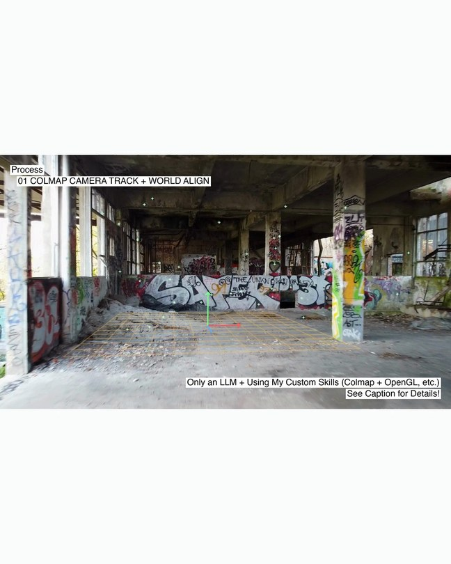
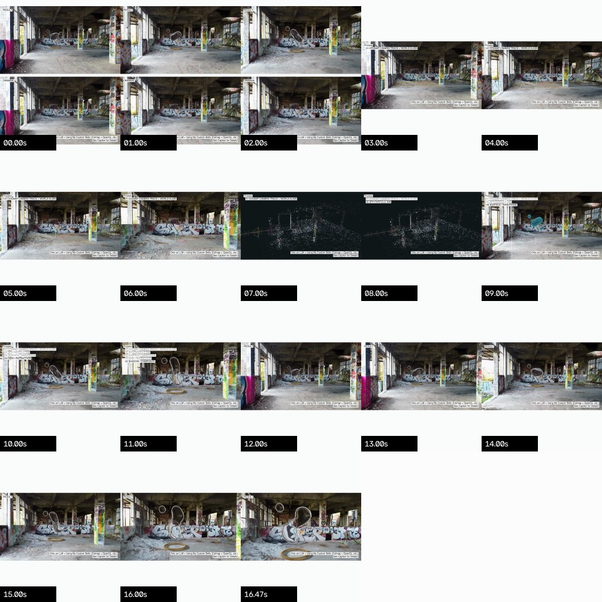

# 실사 VFX 브레이크다운 제작 규칙 — 최종 v7

2026-11-06 사용자 수정 지시를 반영한 **실사 합성 브레이크다운**의 재현 기준이다. 문장 주변 구름·원형·붓 모양 배경과 글자 유영은 폐기했다. 모든 캡션은 **고정된 흰 직사각형**이다.

빈 모델링 공간에서 원형·물을 보여준 1920×1080 테스트는 가능성 확인용 별도 영상이다. 이 문서의 최종 브레이크다운에 그 영상을 삽입하거나 그 편집으로 대체하지 않는다. 사용자가 추가 변경을 요청하면 그 요청이 우선한다.

## 다른 세션에 전달할 짧은 지시

> 이 저장소의 `docs/breakdown/README.md`, `spec.json`과 참고 이미지를 먼저 읽고 실사 브레이크다운을 제작하세요. 1080×1350, 30fps, 모든 캡션은 21px 고정 흰 직사각형이며 줄 간격은 27px입니다. 초록 트래킹 점과 바닥 정렬 격자는 이름만 합치지 말고 **같은 프레임에 동시에** 표시하세요. 이 화면을 3초 보여준 뒤 실제 COLMAP 포인트클라우드, 바로 SPH 입자 단계로 넘어갑니다. 입자→와이어프레임→굴절→그림자 합성은 **한 번 재생되는 같은 소스 시간 위에서** 오른쪽→왼쪽 리니어 와이프로 진행하며 2px 흰 선을 넣습니다. 마지막 와이프의 들어오는 화면은 결과의 첫 프레임이며 `RESULT`로 표시하고 1초 정지한 뒤 결과 전체를 처음부터 재생합니다. 구름 배경·글자 유영·별도 지면 단계·어두워진 플레이트·모델링 테스트 삽입을 다시 넣지 마세요. 가능하면 제공된 조립 스크립트를 사용하고 완성 영상과 프레임 검수 근거를 함께 남기세요.

## 읽을 파일과 실행 순서

1. 이 문서와 [정확한 설정](spec.json), [타임라인 참고 이미지](reference-timeline.jpg)를 읽는다.
2. 실제 숏의 7개 패스를 만들고 [입력 목록 예제](example-passes.json)의 경로를 채운다.
3. [조립 스크립트](../../tools/breakdown/assemble.py)로 대표 프레임부터 출력한다.
4. 전체 출력 후 [검사 스크립트](../../tools/breakdown/verify.py), 대표 프레임, 실제 재생으로 확인한다.
5. 다음 작업자에게 영상 경로·출처·가정·검사 결과·남은 제한을 전달한다.

조립기는 카메라 추정이나 SPH 계산을 대신하지 않는다. 실제 데이터로 만든 패스를 정해진 편집·자막 규칙으로 조립한다. 저장소의 일반 데모와 이 실사 숏의 카메라·원본을 혼동하지 않는다.

## 1. 캔버스와 화면 위치

좌표 원점은 **최종 출력의 좌측 상단**, 사각형 표기는 `[x, y, width, height]`다. CSS 화면 크기나 Retina 픽셀 배율을 섞지 않는다.

| 항목 | 고정값 |
| --- | --- |
| 출력 | 1080×1350, 정사각 픽셀, 30fps, H.264 yuv420p, Rec.709 |
| 기준 영상 | 16.5초 / 495프레임 / 무음 |
| 바깥 여백 | `#fcfefd` |
| 단일 화면 | `[0, 371, 1080, 608]` |
| 도입 비교의 결과 | `[0, 55, 1080, 608]` |
| 도입 비교의 원본 | `[0, 688, 1080, 608]` |
| 입력 패스 | 1280×720, 24fps, 96프레임 |

1280×720을 전체 폭 1080으로 줄이며 높이는 짝수 608로 반올림한다. 원근을 바꾸는 임의 크롭·패닝을 추가하지 않는다. 다른 원본 길이는 임의로 이 샘플의 숫자에 끼워 맞추지 말고 재생 범위·동기화·마지막 결과 재생을 명시적으로 설계한다. 제공 조립기는 위 4초 입력/16.5초 출력 계약을 엄격히 사용한다.

## 2. 모든 캡션의 최종 모양

| 항목 | 최종 규칙 |
| --- | --- |
| 글꼴 | Helvetica Regular, 없으면 Arial. 대체 글꼴은 기록하고 폭·잘림 재검수 |
| 글자 크기 | 제목·번호 단계·하단 두 줄 **모두 21px** |
| 배경 | 줄마다 불투명 흰색 직사각형, 모서리 반경 0, 블러 0, 그림자 0 |
| 글자 움직임 | 없음. 글자별 흔들림·유영·난수 오프셋 모두 0 |
| 각 줄 박스 | 높이 **24px**, 좌우 패딩 **3px**, 기준선은 박스 상단에서 **18px** |
| 줄 간격 | 박스 상단/기준선 간격 **27px**; 보이는 박스 사이 틈은 3px |
| 색 | 현재 단계 검정, 지난 단계 `(125,128,126)` 회색 |
| 진행 표시 | 이전 단계는 누적, 다음 단계는 미리 표시하지 않음 |
| 설명 자막 | 단계 아래 입자 수·키프레임 수·오차 같은 별도 작은 설명줄 없음 |

글자마다의 외곽 바운딩박스로 다음 줄 y를 계산하면 1번/2번 행간이 달라진다. 모든 줄은 **`y = first_y + 27 * row_index`**로 배치한다. 문자별 높이·descender·강조 여부에 따른 간격 변경을 금지한다.

단일 화면의 `Process` 박스는 `(24,395)`, 첫 단계는 `(40,422)`다. 다음 단계들은 y=449, 476, 503, 530이다. `RESULT` 박스도 `(24,395)`를 쓴다. 도입 비교는 위 `RESULT`가 `(24,79)`, 아래 `ORIGINAL`이 `(24,712)`다.

우측 하단은 **각 줄의 흰 박스 오른쪽을 x=1056에 맞춘다.** 오른쪽 여백과 마지막 줄 하단 여백은 실제 영상 사각형 기준으로 각각 24px이다. 단일 화면의 마지막 박스는 y=931..954, 첫 줄은 y=904..927이다. 비교 화면은 아래 원본 사각형의 바닥 y=1296을 기준으로 마지막 줄 y=1248, 첫 줄 y=1221이다. 캔버스 바닥이나 글자 잉크 끝을 기준으로 삼지 않는다.

하단 문구는 정확히 다음 두 줄이다. `Colmap`은 첫 글자 C만 대문자, `OpenGL` 표기는 유지한다.

```text
Only an LLM + Using My Custom Skills (Colmap + OpenGL, etc.)
See Caption for Details!
```



## 3. 단계 순서와 기준 타임라인

프레임 범위는 양 끝 포함이며 0부터 시작한다.

| 출력 시간 | 프레임 | 화면·동작 |
| --- | --- | --- |
| 0–3초 | 0–89 | 위 RESULT / 아래 ORIGINAL 비교, 동시 재생 |
| 3–6초 | 90–179 | 초록 추적점 **+ 바닥 격자/축**을 실사 한 화면에 동시 표시 |
| 6–6.3초 | 180–188 | 통합 추적 화면 → 실제 COLMAP 포인트클라우드로 와이프 |
| 6.3–8초 | 189–239 | 포인트클라우드와 카메라 경로/프러스텀 |
| 8–8.8초 | 240–263 | 포인트클라우드 → SPH 입자 |
| 8.8–9.6초 | 264–287 | SPH 입자 → 표면 와이어프레임 |
| 9.6–10.4초 | 288–311 | 와이어프레임 → HDRI/굴절 |
| 10.4–11.2초 | 312–335 | 굴절 → 그림자 포함 최종 합성 |
| 11.2–11.5초 | 336–344 | 움직이던 합성 → **결과 소스 0번 프레임**으로 와이프, 표시는 RESULT |
| 11.5–12.5초 | 345–374 | 결과 0번 프레임을 30프레임/1초 정지 |
| 12.5–16.5초 | 375–494 | 결과를 소스 0부터 95까지 끝까지 재생 |

화면에 쓰는 번호/이름:

```text
Process
01 COLMAP CAMERA TRACK + WORLD ALIGN
02 SPH PARTICLE SIM
03 SURFACE / WIREFRAME
04 HDRI / REFRACTION
05 SHADOW / COMPOSITE
```

`01 ORIGINAL PLATE`는 **번호 단계에 넣지 않는다.** 도입의 ORIGINAL/RESULT 비교와 혼동하지 않는다. `GROUND / WORLD ALIGN`도 별도 단계로 나누지 않는다. 통합 화면과 포인트클라우드는 모두 01에 속한다. 포인트클라우드 뒤에는 곧바로 02가 온다.

## 4. 와이프와 시간 동기화

- 방향은 **오른쪽에서 왼쪽**. 새 패스가 오른쪽에서 나타나며 경계가 왼쪽으로 이동한다.
- 화면 전체 폭에 걸친 일정 속도 선형 이동이다. ease-in/out, 디졸브, 대각선 마스크를 추가하지 않는다.
- 경계는 **2px의 흰 세로선**이며 영상 사각형 안에서만 보인다. 자막은 와이프 위에 따로 그린다.
- 와이프 시작 출력 프레임은 `180, 240, 264, 288, 312, 336`. 각각 9프레임 샘플 `k=0..8`을 사용한다.
- `u=k/8`, 경계 `x=(1-u)*1080`. 0은 전 화면 이전 패스, 8은 전 화면 다음 패스다. 중간 x는 `945,810,675,540,405,270,135`다.
- 입자부터 그림자까지는 하나의 재생 시계: `source_frame = floor((output_frame-240)*24/30)`. 패스가 바뀔 때 시간을 0으로 되돌리지 않는다.
- **입자↔와이어↔굴절↔최종 합성의 양쪽은 같은 카메라·소스 프레임**이어야 한다. 같은 물체가 경계에서 두 위치/모양으로 갈라지면 실패다.
- 포인트클라우드는 별도의 진단 뷰 카메라라 실사와 시점을 일치시키지 않는다. 진단 뷰에서 입자로 전환하는 경계와 마지막 결과로 돌아오는 경계는 의도된 시점/시간 전환이다.
- 마지막 와이프의 들어오는 영상은 계속 **소스 0번 고정**이다. 와이프가 끝난 뒤에 1초를 추가로 멈추고 전체 결과를 재생한다.
- 물/와이어프레임을 잘 보이게 하려는 목적으로 실사 플레이트를 어둡게 만들지 않는다. 기준은 plate gain=1.0이다.

## 5. 실제 과정이어야 하는 부분

초록 점은 실제 추적 관측/예측, 격자는 실제 카메라로 투영한 지면이다. 임의로 뿌린 초록 점이나 화면 고정 2D 격자로 대체하지 않는다. 포인트클라우드·카메라 경로·SPH 입자·표면은 최종 합성에 사용한 데이터로 만든다.

카메라 내부 파라미터, 종횡비, 주점, 카메라 외부 파라미터, COLMAP↔렌더러 좌표 변환, 왜곡 처리, 프레임 시간, 지면 법선과 축 방향, 스케일을 확인한다. 다른 장면에 예제 카메라와 지면 수치를 그대로 적용하지 않는다.

이 숏의 지면 격자 수평축 회전 **10°**는 뒷벽/바닥의 투시에 맞춘 장면별 값이다. 카메라나 지면 법선을 임의로 돌린 값이 아니며 다른 숏의 보편 규칙도 아니다.

이 예제는 370개 원 SPH 입자 캐시와 Three.js MarchingCubes를 사용한다. 최종 물 픽셀은 ModernGL을 통한 **네이티브 OpenGL**이다. 브라우저 WebGL과 혼용해 보고하지 않는다. 물리 계산은 CPU이며 GPU 렌더러 이름/버전은 실제 컨텍스트에서 기록한다.

아래 원형 받침의 그림자는 실제 토러스 메시를 왼쪽 창문 방향으로 투영한 25개 실루엣을 합성했다. 방향·넓이·세기는 시각적으로 맞춘 가정값이고 광도를 실측하지 않았다. 바닥에 접지되고 광원 반대 방향으로 드리워지는지 확인한다.

**첫 프레임에서 HDRI를 추출했다고 주장하지 않는다.** 이 숏은 별도 CC0 HDRI를 사용한다. 물의 화면 공간 굴절, 국소 평면 지면, 절대 스케일에는 근사가 있다. 단계 이름 `HDRI / REFRACTION` 자체가 영상에서 HDRI를 추출했다는 뜻은 아니다.

## 6. 제공 조립기 실행

Python 3.11 이상, FFmpeg/ffprobe와 `numpy`, `opencv-python`, `Pillow`가 필요하다. 폰트 파일은 저장소에 포함하지 않는다. 예제 manifest를 자신의 작업 폴더에 복사하고 **경로를 실제 패스로 수정**한다.

필수 패스는 `original`, `result`, `tracking_ground`, `pointcloud`, `particles`, `wireframe`, `refraction`이다. `result`에는 최종 링 그림자가 포함된다. 7개 모두 같은 원본 범위의 96프레임/24fps/1280×720이어야 한다. `.rgb`를 쓰면 프레임 순서의 RGB24 raw 데이터이며 크기는 정확히 265,420,800바이트다. MP4 입력은 출력 폴더의 cache에 디코딩한다. RGB 덤프는 타임스탬프가 없으므로 생성 시점에 동기화를 보증해야 한다.

```sh
python -m pip install -r tools/breakdown/requirements.txt

python tools/breakdown/assemble.py \
  --manifest /path/to/passes.json --output /path/to/new-breakdown \
  --font /path/to/Helvetica.ttc --stills 0 5 7 9.1 13.5

python tools/breakdown/assemble.py \
  --manifest /path/to/passes.json --output /path/to/new-breakdown \
  --font /path/to/Helvetica.ttc

python tools/breakdown/verify.py --output /path/to/new-breakdown
```

전체 출력은 기존 최종 MP4가 있으면 중단한다. 재수정은 새 폴더에서 한다. 결과물은 `01_Water_Breakdown_Final_v7_1080x1350.mp4`, `style.json`, `edit-decision-list.json`, `layout-bounds.json`, 프리뷰다. 폰트를 생략하면 설치된 Helvetica/Arial/DejaVu Sans를 순서대로 찾으며 실제 사용 경로를 출력 설정에 기록한다. 다른 글꼴이면 반드시 폭·줄맞춤을 재검수한다.

## 7. 완료 판정

- 최종 MP4 전체를 디코딩하고 크기·fps·길이·프레임 수·검은 화면·누락을 확인한다.
- 모든 자막의 네모 모서리, 고정 위치, 21px 크기, 27px 간격, 24px 우측/하단 여백을 확인한다.
- 통합 추적 화면에서 **점과 격자가 동시에 움직이는지** 확인한다. 제목만 합쳐진 경우 실패다.
- 시작·중간·끝과 모든 와이프의 앞/중간/뒤 프레임을 본다. 가능하면 전체 구간을 플레이어에서도 재생한다. 전체 재생을 관찰하지 못했다면 프레임 검수를 전체 재생 검수라고 쓰지 않는다.
- 04/05 구간 플레이트 밝기, 지면 미끄러짐·떨림, 물체 가림, 링 접지·그림자, 흰 경계선, 물체의 와이프 양쪽 일치를 확인한다.
- 마지막 와이프 뒤 소스 0번을 정확히 1초 유지하고 0부터 끝까지 다시 재생하는지 확인한다.
- 카메라 수치 검증은 별도로 남긴다. 이 숏의 검증 트랙 752개 p95 재투영 오차는 1280×720에서 1.387px이며 다른 영상의 품질 보증 수치로 재사용하지 않는다.
- 소스 URL·제작자·라이선스, 실제 렌더러, 가정/근사, 파일 해시, 검사 범위와 미확인 사항을 기록한다.

장시간 작업은 세션과 분리된 실행 방식, PID/실행 ID·명령·로그·종료 코드·입출력·재개 지점을 기록한다. 재개할 때 실행 상태를 먼저 확인해 중복 렌더를 막는다. 여러 예제는 한 편의 제작과 검수를 마친 다음 다음 편으로 진행한다.

## 8. 참고 이미지와 출처



참고 이미지는 이 규칙으로 만든 v7 영상에서 추출한 축소 프레임이다. 공개 저장소에는 원본 전체 영상·개인 레퍼런스 영상·대용량 캐시를 포함하지 않는다.

- 실사 원본: **Florian Delée / Pexels**, [abandoned building drone video 13939575](https://www.pexels.com/video/drone-video-of-the-interior-of-an-abandoned-building-13939575/), [Pexels License](https://www.pexels.com/license/). 무료 사용·수정이 가능한 라이선스이며 CC0라고 표기하지 않는다.
- 조명: **Sergej Majboroda / Poly Haven**, [Abandoned Factory Canteen 01](https://polyhaven.com/a/abandoned_factory_canteen_01), [CC0](https://polyhaven.com/license/).
- 숫자·가정·검증 결과는 [최종본 검수 기록](validation.json)에서 확인한다. 비밀값·계정 정보는 포함하지 않는다.
